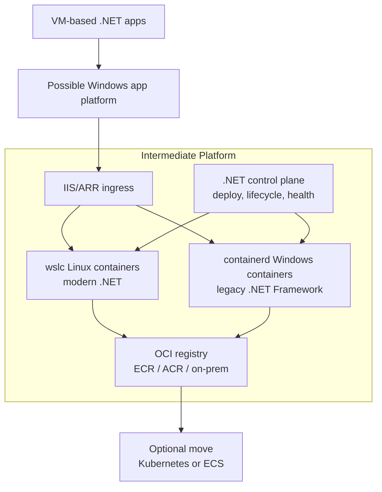

# .NET Framework Modernization Notes

## References

- [ASP.NET Framework to ASP.NET Core migration](https://learn.microsoft.com/en-us/aspnet/core/migration/fx-to-core/?view=aspnetcore-10.0)
- [OpenSilver](https://opensilver.net/) and [OpenRiaServices](https://openriaservices.gitbook.io/openriaservices), which may be relevant if legacy Silverlight applications are still in scope.
- AI usage: use GitHub Copilot for drafts, then validate with human review; Web Forms vs MVC matters here and can change prompting and migration steps.

## Definitions

| Term | Meaning | Link |
|---|---|---|
| YARP | Yet Another Reverse Proxy for .NET, often used for progressive routing | [YARP](https://github.com/microsoft/reverse-proxy) |
| IIS | Internet Information Services, Microsoft web server for Windows | [IIS](https://learn.microsoft.com/en-us/iis/) |
| ARR | Application Request Routing extension for IIS | [ARR](https://www.iis.net/downloads/microsoft/application-request-routing) |
| wslc | WSL container CLI/API capability for Linux containers from Windows | [WSL container](https://learn.microsoft.com/en-us/windows/wsl/wsl-container?tabs=csharp), [WSL container API](https://wsl.dev/api-reference/) (preview; validate production support) |
| containerd | Container runtime used for container lifecycle management | [containerd](https://containerd.io/) |
| OCI | Open Container Initiative standards for images and runtimes | [OCI](https://opencontainers.org/) |
| ECR | Amazon Elastic Container Registry | [Amazon ECR](https://aws.amazon.com/ecr/) |
| ACR | Azure Container Registry | [Azure Container Registry](https://learn.microsoft.com/en-us/azure/container-registry/) |

## Incremental Updates and Side-by-Side Option

For incremental updates, side-by-side can be another option.

One approach is to use YARP for progressive routing during migration; another option is to run separate side-by-side applications.

- Keep the legacy app stable while moving modules incrementally.
- Route and/or navigate selected paths to the new app first.

Enablers: reverse proxy/gateway and shared auth/session.

## Exploratory Idea

Idea (very exploratory): inspired by the API capability exposed by WSL containers (including launching and managing containers from a .NET application), this could support a progressive port instead of a full rewrite.

- Goal: modernize incrementally while keeping the legacy .NET Framework app stable.
- Platform concept: use a lightweight intermediate platform between traditional VMs and Kubernetes.
- Legacy workload path: run legacy .NET Framework apps in Windows containers via `containerd`.
- Modern workload path: run modern .NET apps in Linux containers via wslc.
- Control path assumption: the .NET control plane calls the wslc API to launch and manage Linux containers.
- Shared ingress: use IIS/ARR to route traffic to both legacy and modern workloads.
- Image source: use an OCI-compatible registry (for example ECR, ACR, or on-prem).

- Registry options can include Azure Container Registry, Amazon ECR, or an on-premises registry.

### Security Considerations

Secure deployment APIs and admin actions with strong authentication and authorization. Use only trusted signed images from approved registries, store secrets safely with least-privilege access, and apply RBAC for people and automation. Isolate network traffic between ingress, control plane, and workloads, and keep audit logs for deploy, rollback, image pull, and routing changes.
